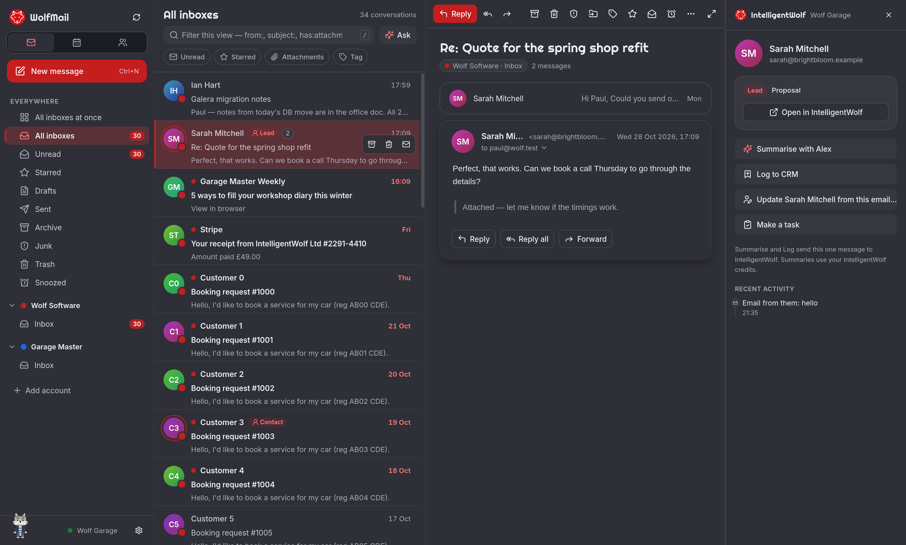
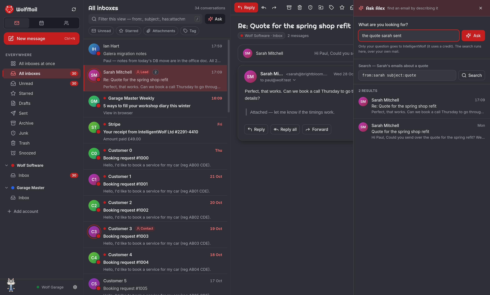

# WolfMail

**A fast, private desktop email client for all your accounts — Windows, macOS and Linux.**

WolfMail puts every inbox you have — Gmail, Outlook, and any IMAP mailbox — in one window, keeps your mail on your
own computer, and gets out of your way. Free and open source.



## What you get

- **Every inbox in one place** — Gmail and Google Workspace, Outlook and Microsoft 365, and any IMAP/SMTP mailbox.
  An "All inboxes" view, or every inbox side by side.
- **Moving from Thunderbird or Betterbird?** WolfMail finds your accounts and imports them in one step.
- **Private by default** — your mail and passwords stay on your computer (in your system keychain, or an encrypted
  vault). Remote images and tracking pixels are blocked until you choose to load them.
- **Built for speed** — conversations, keyboard shortcuts for everything (press `?`), instant search with
  `from:` `subject:` `has:attachment` `is:unread` `after:` `before:`, snooze, filters, tags and undo send.
- **Calendar and contacts** alongside your mail.

## Better with IntelligentWolf

[**IntelligentWolf**](https://intelligentwolf.com) is an AI team for your business. You just ask. Connect it and
WolfMail becomes the front desk of your business:

- **Your customers, highlighted** — emails from your leads and contacts are marked in the list, with their record,
  pipeline stage and history beside every email.
- **Update a contact from an email** — right-click: the email goes on their history, and Alex picks out the new phone
  number, job title or address for you to confirm.
- **Alex in the corner** — your IntelligentWolf assistant, right in your inbox: ask about an email, draft a reply,
  make a task. (Give him any name you like.)
- **Ask** — find an email by describing it: *"the quote Sarah sent last week"*.



WolfMail never sends your mail anywhere on its own. To mark your contacts it checks senders' addresses; an email's
content goes to IntelligentWolf only when you choose to send it. Details: [docs/IW-INTEGRATION.md](docs/IW-INTEGRATION.md).

**Don't have an account?** Visit [intelligentwolf.com](https://intelligentwolf.com).

## Download

Installers for Windows, macOS and Linux are on the [Releases](../../releases) page. WolfMail updates itself.

### Verify your download

Every release publishes a `SHA256SUMS` file, a [Sigstore cosign](https://docs.sigstore.dev/) signature for each file
(`<file>.cosign.bundle`, keyless — the signer is this repository's release workflow) and a
[SLSA build provenance](https://slsa.dev/spec/v1.0/provenance) attestation, as WolfStack's releases do.

```sh
sha256sum -c SHA256SUMS --ignore-missing                                   # Linux
shasum -a 256 -c SHA256SUMS --ignore-missing                               # macOS
Get-FileHash .\<file> -Algorithm SHA256                                   # Windows: compare with SHA256SUMS

gh attestation verify <file> --repo intelligentwolf/wolfmail           # built by this repo's workflow

cosign verify-blob --bundle <file>.cosign.bundle \
  --certificate-identity-regexp 'https://github.com/intelligentwolf/wolfmail/\.github/workflows/release\.yml@.*' \
  --certificate-oidc-issuer 'https://token.actions.githubusercontent.com' <file>
```

## Build from source

You need Node.js 22 and Rust (the version is pinned in `rust-toolchain.toml`; `rustup` installs it). On Linux you also
need the [Tauri system packages](https://v2.tauri.app/start/prerequisites/).

```sh
npm ci
npx tauri dev          # run it
npx tauri build        # build an installer
```

Signing in with Google or Microsoft needs your own OAuth client IDs at build time (`WOLFMAIL_GOOGLE_CLIENT_ID`,
`WOLFMAIL_GOOGLE_CLIENT_SECRET`, `WOLFMAIL_MS_CLIENT_ID`); without them that sign-in says it isn't available in the
build and offers an app password instead. IMAP accounts work as normal. Tests: `cargo test --workspace` and `npx tsc --noEmit`.

The app's engine ↔ interface contract is in [docs/API.md](docs/API.md).

## Contributing

WolfMail is open source, but **we don't accept outside contributions** — pull requests from outside IntelligentWolf
Ltd are closed automatically. Bug reports and ideas are welcome as [issues](../../issues). Security problems: please
report privately (see [SECURITY.md](SECURITY.md)), not in a public issue.

## Licence

WolfMail is free software under the [GNU General Public License v3.0 or later](LICENSE): you may use, study, change
and share it; if you distribute a changed version, you must share its source under the same licence.

"WolfMail", "IntelligentWolf", "Alex" and the wolf logos and artwork are trademarks of IntelligentWolf Ltd and are not
covered by the licence — please use your own name and branding for a modified version.

© IntelligentWolf Ltd
